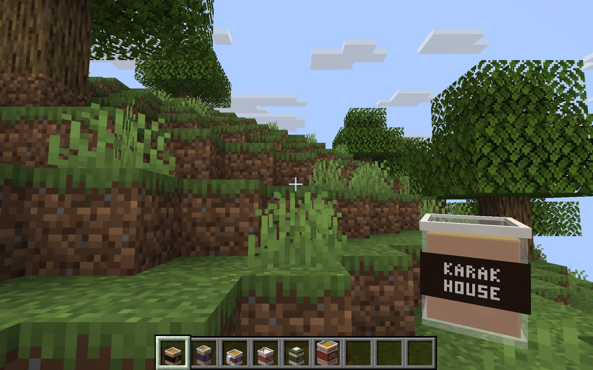
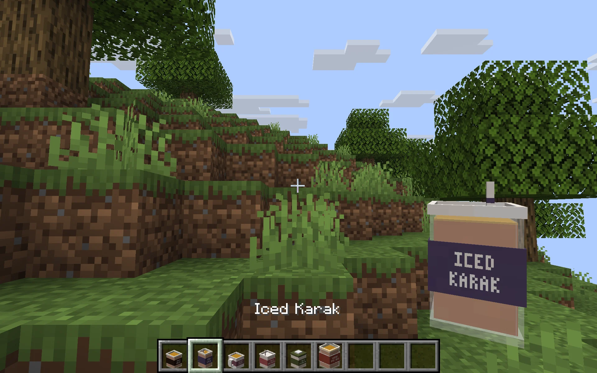
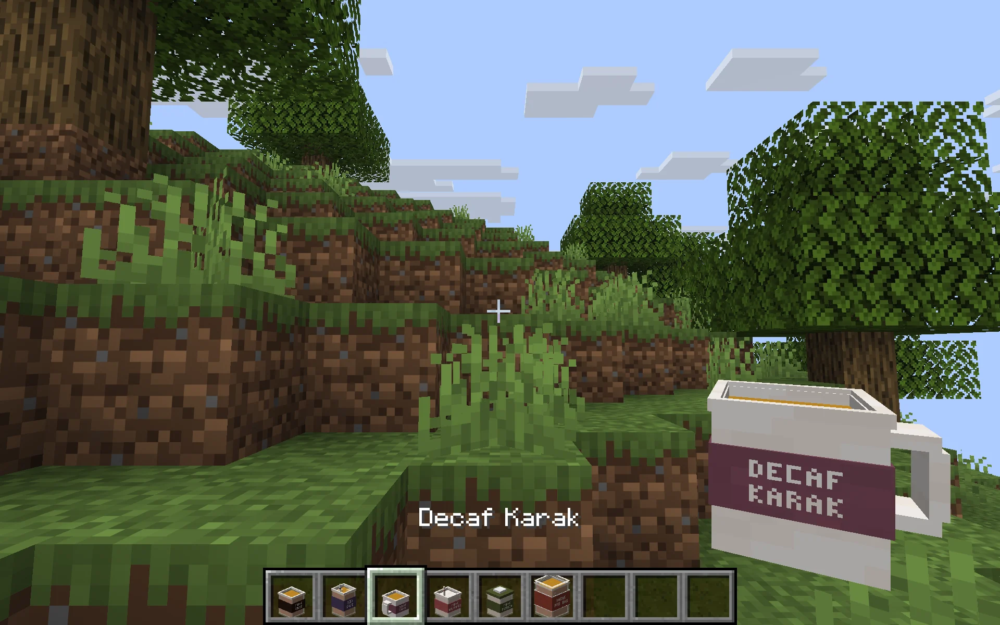
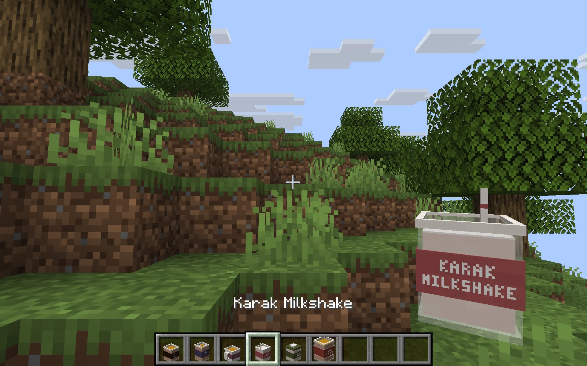
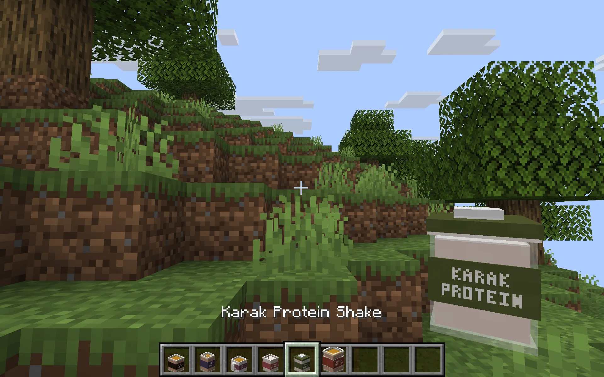
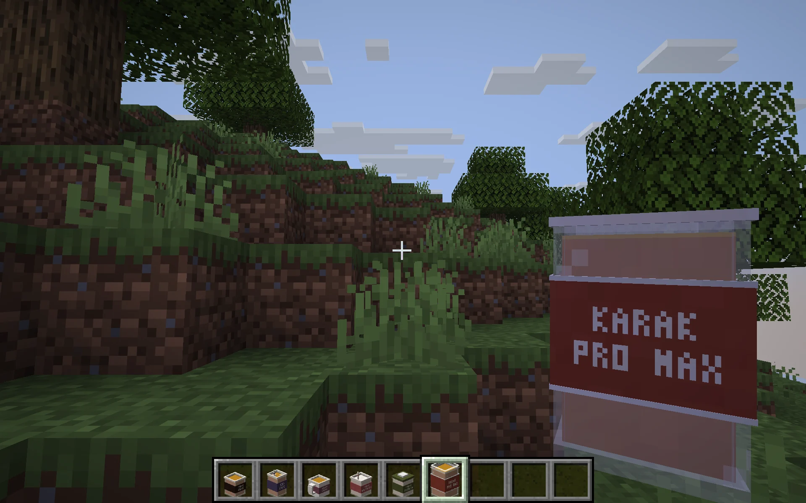
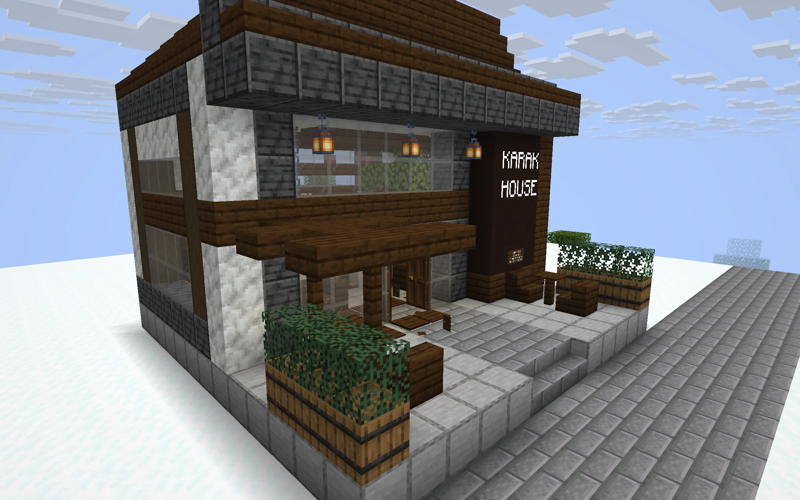

# Karak Tea for Minecraft Horizon

A personal Minecraft mod for the Rust-based Horizon client. Discover modern Karak Houses in villages and buy superhero tea.

**Development build. Not yet qualified for public download.**

The repository remains private until gameplay acceptance tests pass.

## Current preview

[The 0.2.0 menu and stacking rules](docs/Menu_0.2.0.md) are available in the new private showcase. Final visual review and end-to-end qualification remain open.

## Gameplay

- Maximum one Karak House per village, with five biome-specific designs.
- One emerald buys exactly one Karak Tea. No copper or random prices.
- Each seller has an independent 10% daily chance of offering one free cup.
- Drinks have distinct powers and durations; regular Karak grants six status effects and fall protection for five minutes.

## Compatibility

Targets Horizon nightly-2026-11-05-66f3981 as a standard Horizon content pack. No custom client or native extension is required. This is not a Fabric, Forge, NeoForge, or Bedrock mod. Requires the player’s own Minecraft Java Edition through Horizon.

## Installation and play

See [Installation](docs/Installation.md) for the development-preview setup, prices, free cups, power effects and removal instructions.

## Development

Source pack is in `pack/`. `scripts/build.py` builds the pack; gameplay and world-generation definitions live in separate modules.

## Attribution

Inspired by Dubai karak tea shops. Independent fan project, not affiliated with Karak House, Mojang, Microsoft, or Horizon. Minecraft textures are referenced from the player’s installation and are not redistributed.

## Design review

Village integration and public release are held for the owner’s review. The images below are isolated design previews rendered in Horizon, not evidence of completed village-generation or gameplay acceptance.

### Drinks

The six in-game cup designs have distinct shapes and labels. These screenshots show the current private preview.








### Plains


### Desert


### Savanna


### Taiga


### Snowy



## Build the pack

```sh
python3 -m venv .venv
.venv/bin/pip install -r requirements-dev.txt
.venv/bin/python scripts/build.py
.venv/bin/python -m unittest discover -s tests -v
```

Build output: `dist/Karak_Tea_0.2.0.hmod`. Development-only until acceptance testing is complete.

## License

Original mod source, models, structures and documentation are under the [MIT License](LICENSE). Referenced Minecraft assets remain the property of their respective owners and are supplied by the player’s Minecraft installation.
