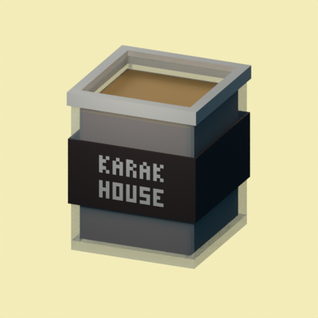
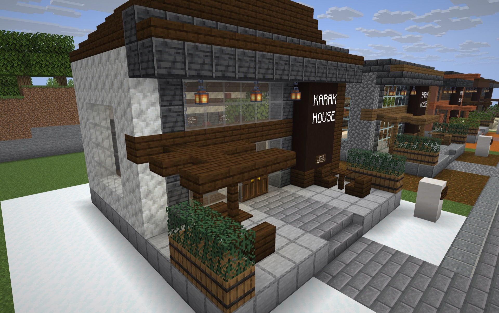

<p align="center">
  <a name="karak-tea"></a>
  <picture>
    <source media="(prefers-color-scheme: dark)" srcset="docs/assets/README_Title_Dark.svg">
    
  </picture>
</p>

<p align="center"><strong>A little taste of Dubai in your Minecraft villages.</strong><br>
Find a Karak House, meet its seller, and enjoy a cup with extraordinary powers.</p>

<p align="center"></p>

<p align="center"><a href="https://github.com/Kian-hdr/karak-tea-minecraft/releases/download/v0.2.0/Karak_Tea_0.2.0.hmod"></a></p>

<p align="center"><strong>Horizon 26.3 · Nightly <code>66f3981</code> · Version 0.2.0</strong><br>
<a href="#install">Installation</a> · <a href="#the-menu">The menu</a> · <a href="#house-gallery">House gallery</a> · <a href="#make-it-your-own">Contributing</a></p>

> **UNOFFICIAL MINECRAFT MOD. NOT APPROVED BY OR ASSOCIATED WITH MOJANG OR MICROSOFT.**<br>
> Created by Kian Konrad · Contact: [contact@kiankonrad.me](mailto:contact@kiankonrad.me)


## Visit a Karak House

Karak Houses appear in newly generated villages, with a design suited to the local landscape. Follow the village path to a shop, meet the seller behind the counter, and trade emeralds for a drink. Each village can have up to one Karak House.

Each seller has a **10% chance each Minecraft day** to offer a complimentary regular Karak Tea. The first player to claim it gets one cup, and the paid menu stays available.

## Install

1. Download the [Karak Tea 0.2.0 mod](https://github.com/Kian-hdr/karak-tea-minecraft/releases/download/v0.2.0/Karak_Tea_0.2.0.hmod).
2. In Horizon, open the game folder for the instance you want to use and place the file in its `horizon-mods` folder.
3. Start the instance, open **Options → Mods**, and enable **Karak Tea**.
4. Restart the game, then explore newly generated villages.

The pack targets Horizon nightly **2026-11-05 (`66f3981`)**, using the standard Horizon client. See the [installation guide](docs/Installation.md) for details. Follow the [Horizon catalog submission](https://github.com/horizon-rust/horizon-mods/pull/375) for its review status.

### Set up with an AI agent

Copy this prompt into an agent that can use your computer:

```text
Install Karak Tea 0.2.0 for me in my existing Horizon instance. Complete the setup and verify it works.

1. Inspect the installed Horizon launcher, its selected instance, and its game version. Use the selected instance unless I specify another one. If Horizon is missing, install it using the official instructions at https://playhorizon.dev/docs/install and prepare it using my own Minecraft: Java Edition account and files. Let me handle any required sign-in or security prompts.
2. This mod was tested with Horizon nightly 2026-11-05, revision 66f3981, for Minecraft 26.3. Check the target instance's version. If it differs, explain the compatibility uncertainty and ask me before changing that instance's version or replacing any game files.
3. Download https://github.com/Kian-hdr/karak-tea-minecraft/releases/download/v0.2.0/Karak_Tea_0.2.0.hmod and verify SHA-256 ea0db324ecfab441994811829cd3cd544b522576438a2f597a9f956b71f57b64. Stop if the checksum does not match.
4. Install the verified file in the target instance's horizon-mods folder and enable the mod with ID karak_house. Preserve existing settings, other mods, instances, and worlds. If a different Karak Tea version is already installed, inspect it and ask me before replacing or removing it. Don't modify a running game or its open world.
5. Restart the game if needed. Verify Karak Tea 0.2.0 is enabled under the game's Options > Mods, and tell me how to find the mod in newly generated villages. Report the instance, version, verification result, and any step that requires my action. Do not claim that a launcher catalog listing exists unless you verify it.
```

## The menu

Each trade gives one serving. Prices below are the seller’s **base prices**; Horizon’s villager effects can change higher-priced offers.

| Drink | Base price | Duration | Powers |
|:--|--:|:--|:--|
| **Karak Tea** | 1 emerald | 5 min | Strength IV, Speed III, Jump Boost III, Resistance II, Regeneration I, Fire Resistance and fall protection |
| **Iced Karak** | 1 emerald | 5 min | Fire Resistance and Water Breathing |
| **Decaf Karak** | 1 emerald | 5 min | Night Vision and Regeneration I |
| **Karak Milkshake** | 2 emeralds | 5 min | Clears harmful effects, then rapidly clears Poison, Nausea and Hunger |
| **Karak Protein Shake** | 3 emeralds | 5 min | Strength VII |
| **Karak Pro Max** | 8 emeralds | 30 min | Strength VI, Speed IV, Jump Boost IV, Resistance III, Regeneration II, Fire Resistance and fall protection |

Different drinks stack their powers and expire independently. Drinking the same variety again refreshes its timer. See the [full menu](docs/Menu_0.2.0.md) for details.

## House gallery

Five designs bring the same modern tea-house feel to different village styles. Each has a paved approach, a tea counter, seating and its own materials.

<table>
<tr><td align="center"><strong>Plains</strong><br></td><td align="center"><strong>Desert</strong><br></td></tr>
<tr><td align="center"><strong>Savanna</strong><br></td><td align="center"><strong>Taiga</strong><br></td></tr>
<tr><td align="center"><strong>Snowy</strong><br></td><td align="center"><strong>Meet the seller</strong><br></td></tr>
</table>

Each drink has its own cup and pixel-style inventory icon, with a three-dimensional model when held.

<table>
<tr><td align="center"><strong>Karak Tea</strong><br></td><td align="center"><strong>Iced Karak</strong><br></td><td align="center"><strong>Karak Pro Max</strong><br></td></tr>
</table>

## Make it your own

Karak Tea is open source under the [MIT License](LICENSE). Explore the editable structures, models and functions in `pack/`, and the generators in `scripts/`. Contributions are welcome through pull requests.

```sh
python3 -m venv .venv
.venv/bin/pip install -r requirements-dev.txt
.venv/bin/python scripts/build.py
.venv/bin/python -m unittest discover -s tests -v
```

Inspired by Dubai’s karak tea culture. Minecraft assets are supplied through the player’s game installation. For questions about the project, contact [contact@kiankonrad.me](mailto:contact@kiankonrad.me).
