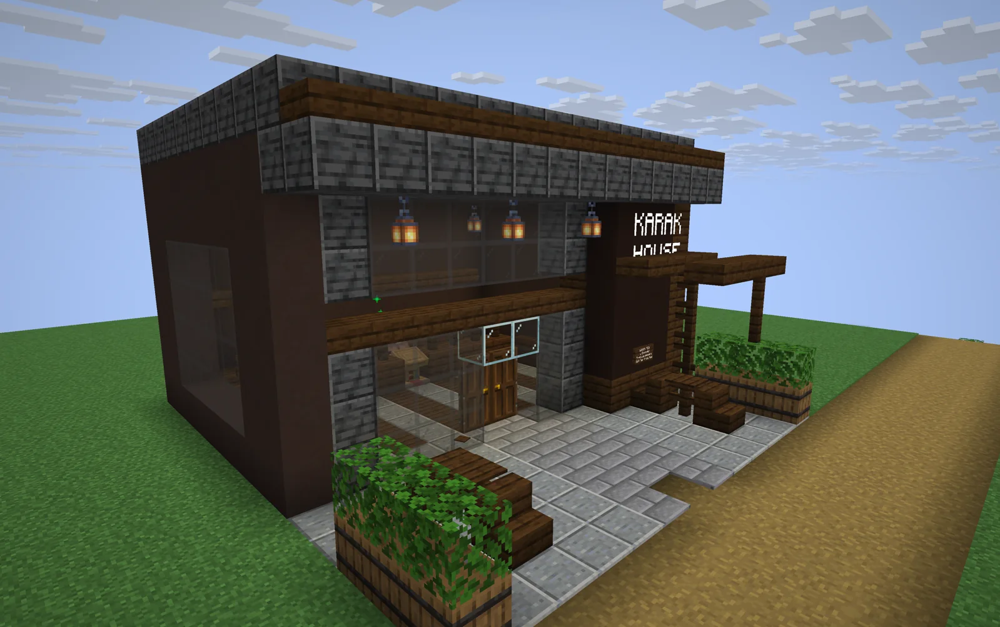
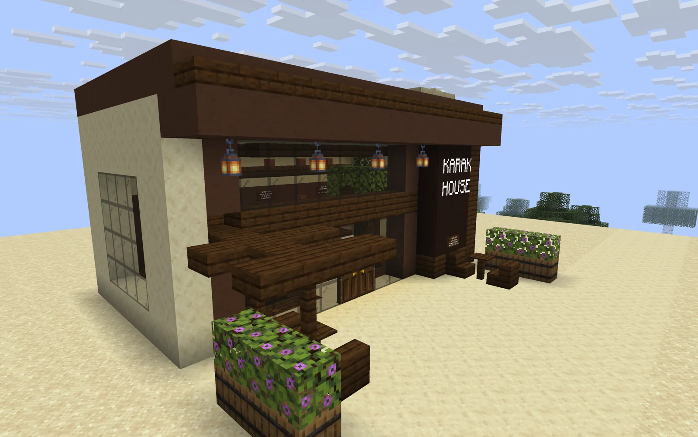
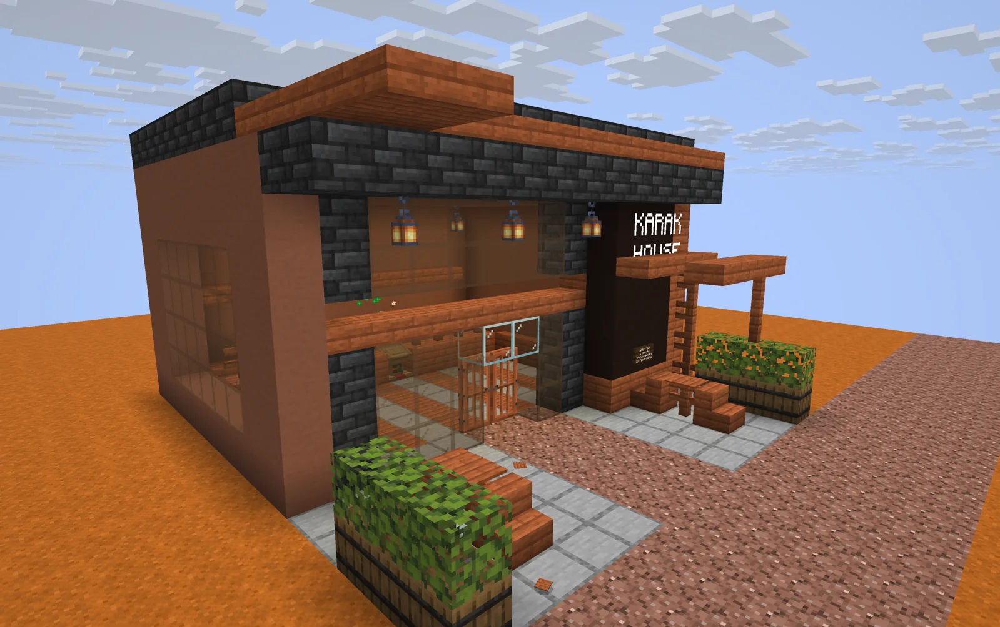
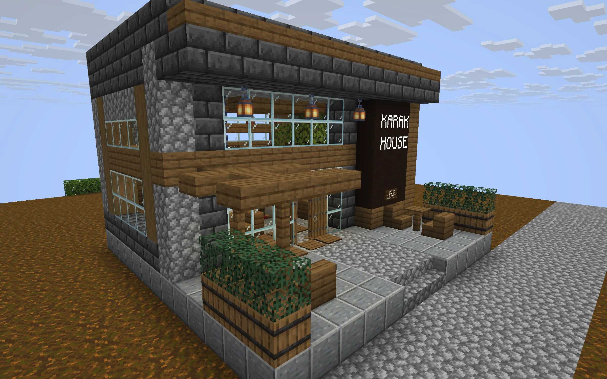
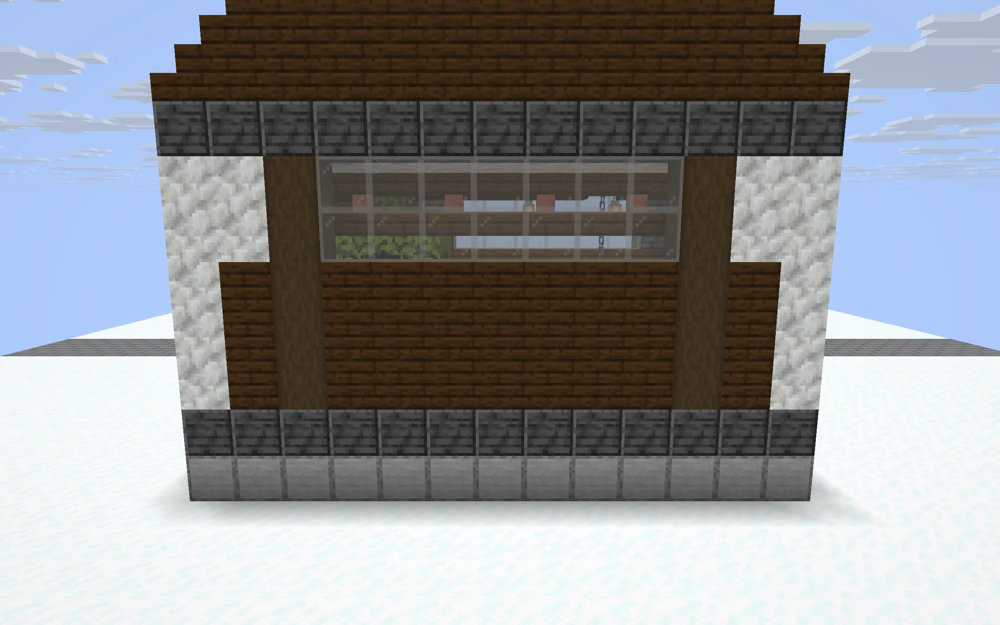
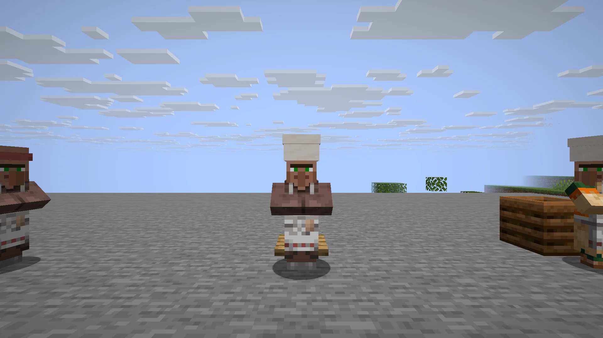

<div align="center">

# Karak Tea

**A little taste of Dubai in your Minecraft villages.**<br>
Find a Karak House, meet its seller, and enjoy a cup with extraordinary powers.

[](https://github.com/Kian-hdr/karak-tea-minecraft/releases/download/v0.2.0/Karak_Tea_0.2.0.hmod)

**Horizon 26.3 · Nightly `66f3981` · Version 0.2.0**<br>
[Installation](#install) · [The menu](#the-menu) · [House gallery](#house-gallery) · [Contributing](#make-it-your-own)

</div>

> **UNOFFICIAL MINECRAFT MOD. NOT APPROVED BY OR ASSOCIATED WITH MOJANG OR MICROSOFT.**<br>
> Created by Kian Konrad · Contact: [contact@kiankonrad.me](mailto:contact@kiankonrad.me)



## Visit a Karak House

Karak Houses appear in newly generated villages, with a design suited to the local landscape. Follow the village path to a shop, meet the seller behind the counter, and trade emeralds for a drink. Each village can have up to one Karak House.

Each seller has a **10% chance each Minecraft day** to offer a complimentary regular Karak Tea. The first player to claim it gets one cup, and the paid menu stays available.

## Install

1. Download the [Karak Tea 0.2.0 mod](https://github.com/Kian-hdr/karak-tea-minecraft/releases/download/v0.2.0/Karak_Tea_0.2.0.hmod).
2. In Horizon, open the game folder for the instance you want to use and place the file in its `horizon-mods` folder.
3. Start the instance, open **Options → Mods**, and enable **Karak Tea**.
4. Restart the game, then explore newly generated villages.

The pack targets Horizon nightly **2026-11-05 (`66f3981`)**, using the standard Horizon client. See the [installation guide](docs/Installation.md) for details.

## The menu

Each trade gives one serving. Prices below are the seller’s **base prices**; Horizon’s villager effects can change higher-priced offers.

| Drink | Base price | Duration | Powers |
|:--|--:|:--|:--|
| **Karak Tea** | 1 emerald | 5 min | Strength IV, Speed III, Jump Boost III, Resistance II, Regeneration I, Fire Resistance and fall protection |
| **Iced Karak** | 1 emerald | 5 min | Fire Resistance and Water Breathing |
| **Decaf Karak** | 1 emerald | 5 min | Night Vision and Regeneration I |
| **Karak Milkshake** | 2 emeralds | 5 min | Clears harmful effects, then rapidly clears Poison, Nausea and Hunger |
| **Karak Protein Shake** | 3 emeralds | 5 min | Strength VII |
| **Karak Pro Max** | 8 emeralds | 30 min | Strength VI, Speed IV, Jump Boost IV, Resistance III, Regeneration II, Fire Resistance and fall protection |

Different drinks stack their powers and expire independently. Drinking the same variety again refreshes its timer. See the [full menu](docs/Menu_0.2.0.md) for details.

## House gallery

Five designs bring the same modern tea-house feel to different village styles. Each has a paved approach, a tea counter, seating and its own materials.

<table>
<tr><td align="center"><strong>Plains</strong><br></td><td align="center"><strong>Desert</strong><br></td></tr>
<tr><td align="center"><strong>Savanna</strong><br></td><td align="center"><strong>Taiga</strong><br></td></tr>
<tr><td align="center"><strong>Snowy</strong><br></td><td align="center"><strong>Meet the seller</strong><br></td></tr>
</table>

Each drink has its own cup and pixel-style inventory icon, with a three-dimensional model when held.

## Make it your own

Karak Tea is open source under the [MIT License](LICENSE). Explore the editable structures, models and functions in `pack/`, and the generators in `scripts/`. Contributions are welcome through pull requests.

```sh
python3 -m venv .venv
.venv/bin/pip install -r requirements-dev.txt
.venv/bin/python scripts/build.py
.venv/bin/python -m unittest discover -s tests -v
```

Inspired by Dubai’s karak tea culture. Minecraft assets are supplied through the player’s game installation. For questions about the project, contact [contact@kiankonrad.me](mailto:contact@kiankonrad.me).
